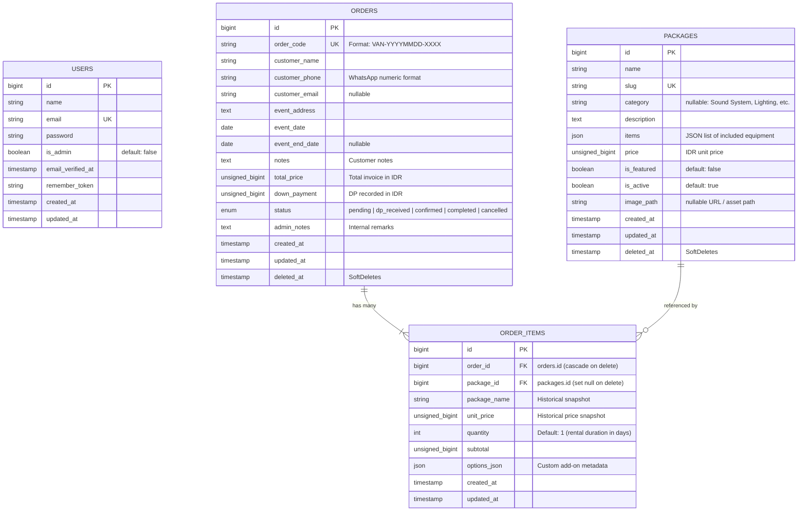
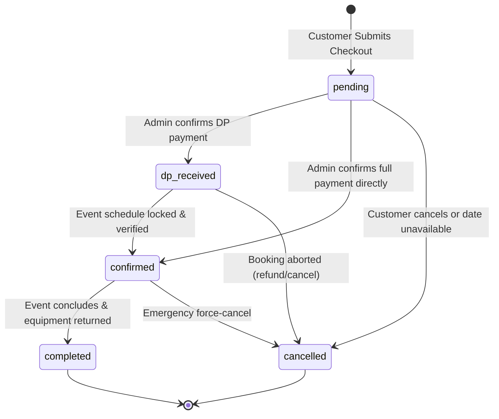

# System Architecture & Technical Specification: Vantara Production
**Document Type:** AI-Consumable System Blueprint & Technical Specification  
**Application Name:** Vantara Production (Sistem Informasi Manajemen Penyewaan & Pemesanan Layanan Event)  
**Version:** 1.0.0 (Production / Active)  
**Target Audience:** Autonomous Coding Agents, LLMs, Technical Architects, Full-stack Developers  

---

## 1. Executive System Overview

### 1.1 Business Domain
**Vantara Production** is an event production and equipment rental management platform (Sound System, Lighting, Multimedia, Stage Rigging, and Event Packages) designed for the Indonesian market. The platform bridges public consumer exploration (checking dates, exploring packages, booking equipment) with a back-office administration portal (inventory CRUD, order lifecycle processing, financial analytics, and PDF report export).

### 1.2 Target Personas
1. **End-User / Customer:**
   - Browses package catalogs and individual service breakdowns.
   - Checks calendar availability for event dates in real-time.
   - Adds packages to a temporary cart session.
   - Completes checkout with event logistics and WhatsApp contact details.
   - Receives a booking confirmation code (`VAN-YYYYMMDD-XXXX`) to track booking status.
2. **Administrator / Operations Staff:**
   - Authenticated access via `is_admin = true` role.
   - Monitors live metrics (Gross Revenue, Pending Orders, Upcoming Events).
   - Manages package items, pricing, categories, and active statuses.
   - Adjusts order pricing, records Down Payment (DP) sums, and alters order status.
   - Generates and exports filtered monthly sales reports to PDF and print-ready formats.

---

## 2. Technology Stack & Environment

| Layer | Technology | Version / Spec | Description |
| :--- | :--- | :--- | :--- |
| **Runtime** | PHP | `^8.3` | Strict types, constructor promotion, modern attributes |
| **Framework** | Laravel | `^13.17` | Full-stack MVC framework |
| **Database** | SQLite / MySQL | Compatible with both | Default dev: SQLite (`database/database.sqlite`), production-ready MySQL |
| **ORM** | Eloquent | Laravel Built-in | Model casting, SoftDeletes, Scopes, JSON column casts |
| **Frontend Templates** | Blade | Laravel Built-in | Componentized layouts: `layouts.app` and `layouts.admin` |
| **CSS Framework** | Tailwind CSS | `v4.0.0` (`@tailwindcss/vite`) | Custom `@theme` Gatsby Art Deco Noir design tokens |
| **JavaScript UI** | Alpine.js | `^3.17.4` | Lightweight reactivity for modals, dropdowns, and calendar interactivity |
| **Build Tool** | Vite | `^8.0.0` | `laravel-vite-plugin ^3.1` |
| **PDF Generation** | DomPDF | `barryvdh/laravel-dompdf ^3.1` | Generates A4 PDF financial reports |
| **Testing Suite** | PHPUnit | `^12.5.12` | Feature & Schema tests with `RefreshDatabase` |
| **Code Style** | Laravel Pint | `^1.27` | PSR-12 + Laravel standard linter |
| **Serverless Ready**| Vercel | PHP Runtime | Configured via `vercel.json` and `api/index.php` |

---

## 3. Database Schema & Entity Relationships (ERD)



### 3.1 Detailed Column Specifications

#### `packages` Table
- `id` (BIGINT, Auto-Increment, Primary Key)
- `name` (VARCHAR 255)
- `slug` (VARCHAR 255, Unique Index)
- `category` (VARCHAR 255, Nullable) — Examples: `Sound System`, `Lighting`, `Genset & Power`, `Multimedia`
- `description` (TEXT)
- `items` (JSON, Nullable) — Cast to PHP `array`. Contains equipment bullet points.
- `price` (UNSIGNED BIGINT) — Stored in Indonesian Rupiah (IDR) without decimals.
- `is_featured` (BOOLEAN, Default: `false`)
- `is_active` (BOOLEAN, Default: `true`)
- `image_path` (VARCHAR 255, Nullable) — HTTP URL or storage asset path.
- `created_at`, `updated_at` (TIMESTAMPS)
- `deleted_at` (TIMESTAMP, Nullable) — Eloquent `SoftDeletes`.

#### `orders` Table
- `id` (BIGINT, Auto-Increment, Primary Key)
- `order_code` (VARCHAR 255, Unique Index) — Formatted as `VAN-YYYYMMDD-####`.
- `customer_name` (VARCHAR 255)
- `customer_phone` (VARCHAR 20) — Regex-validated numeric string.
- `customer_email` (VARCHAR 255, Nullable)
- `event_address` (TEXT)
- `event_date` (DATE) — Start date of rental.
- `event_end_date` (DATE, Nullable) — End date calculated from rental days.
- `notes` (TEXT, Nullable) — Customer requests / additional instructions.
- `total_price` (UNSIGNED BIGINT, Default: 0) — Total order value.
- `down_payment` (UNSIGNED BIGINT, Default: 0) — Paid Down Payment.
- `status` (ENUM: `'pending'`, `'dp_received'`, `'confirmed'`, `'completed'`, `'cancelled'`, Default: `'pending'`)
- `admin_notes` (TEXT, Nullable) — Internal payment references, vendor contacts, or gear notes.
- `created_at`, `updated_at` (TIMESTAMPS)
- `deleted_at` (TIMESTAMP, Nullable) — Eloquent `SoftDeletes`.

#### `order_items` Table
- `id` (BIGINT, Auto-Increment, Primary Key)
- `order_id` (FOREIGN KEY -> `orders.id`, Cascade on Delete)
- `package_id` (FOREIGN KEY -> `packages.id`, Set Null on Delete)
- `package_name` (VARCHAR 255) — Preserves item title even if the original package is modified/deleted.
- `unit_price` (UNSIGNED BIGINT) — Snapshot of unit price at purchase time.
- `quantity` (INT, Default: 1) — Multiplier (duration in days or unit count).
- `subtotal` (UNSIGNED BIGINT) — `unit_price * quantity`.
- `options_json` (JSON, Nullable) — Cast to PHP `array`.

---

## 4. State Machine & Core Business Logic

### 4.1 Order Status Lifecycle



### 4.2 Availability Check & Date Collision Algorithm
1. The model scope `Order::booked()` filters out `cancelled` orders (`whereNotIn('status', ['cancelled'])`).
2. An event occupies the date interval `[event_date, COALESCE(event_end_date, event_date)]`.
3. An overlap query tests:
   ```sql
   WHERE event_date <= :requested_end_date
     AND COALESCE(event_end_date, event_date) >= :requested_start_date
   ```
4. If `package_id` is passed, the query further checks whether any order item in the colliding order matches that `package_id`.
5. The JSON endpoint `/api/availability/calendar` maps booked ranges into an array of date strings for front-end visual disabling in calendar pickers.

### 4.3 Order Code Generation Formula
The static method `Order::generateOrderCode()` guarantees atomic and collision-free identifiers:
- Prefix: `VAN-{YYYYMMDD}-`
- Sequence: 4-digit zero-padded integer starting at `0001` (e.g. `VAN-20261014-0001`).
- Queries `Order::withTrashed()` to ensure deleted codes are never reused.

### 4.4 Cart & Checkout Processing Flow
1. **Cart Storage:** Session-based under key `cart` (`session()->get('cart', [])`).
2. **Item Schema in Session:**
   ```json
   {
     "id": 1,
     "name": "Paket Lamaran / Akad Nikah",
     "slug": "paket-lamaran-akad-nikah",
     "category": "Sound System",
     "price": 600000,
     "quantity": 1,
     "image_path": "https://..."
   }
   ```
3. **Rental Duration Rule:** `rentDuration = max(1, item['quantity'])`.
4. **Checkout Validation:**
   - `customer_name`: Required, string, max 255.
   - `customer_phone`: Required, numeric regex `/^[0-9]+$/`, max 20.
   - `customer_email`: Nullable, email format.
   - `event_address`: Required, string, max 1000.
   - `event_date`: Required, date format, `>= today`.
   - `notes`: Nullable, string, max 1000.
5. **Database Transaction:**
   - DB transaction opens (`DB::transaction`).
   - Generates `order_code`.
   - Calculates `event_end_date = event_date + (rentDuration - 1) days`.
   - Creates `Order` with `status = 'pending'`, `down_payment = 0`.
   - Iterates cart items and inserts corresponding `OrderItem` records.
   - Flushes session cart (`session()->forget('cart')`).
   - Redirects to `route('checkout.show', $order->order_code)` with success flash message.

---

## 5. HTTP Routing & Controller Architecture

### 5.1 Public Routes (Client-Facing)

| Method | URI | Route Name | Controller & Action | Functionality |
| :--- | :--- | :--- | :--- | :--- |
| `GET` | `/` | `home` | `PackageController@index` | Landing page with hero banner & featured packages |
| `GET` | `/katalog` | `packages.catalog` | `PackageController@catalog` | Full catalog with category & price sorting |
| `GET` | `/paket/{slug}` | `packages.show` | `PackageController@show` | Single package detail & inclusions breakdown |
| `GET` | `/cek-jadwal` | `availability.index` | `AvailabilityController@index` | Interactive booking calendar & date checker UI |
| `GET` | `/api/availability/calendar` | `api.availability.calendar` | `AvailabilityController@calendarData` | JSON API returning array of booked dates for calendar |
| `POST`| `/api/availability/check` | `api.availability.check` | `AvailabilityController@checkDate` | JSON API testing specific date collision |
| `GET` | `/keranjang` | `cart.index` | `CartController@index` | Cart summary view |
| `POST`| `/keranjang/tambah` | `cart.store` | `CartController@store` | Add package to cart |
| `PATCH`| `/keranjang/update/{id}` | `cart.update` | `CartController@update` | Update item quantity / rental duration |
| `DELETE`| `/keranjang/hapus/{id}` | `cart.destroy` | `CartController@destroy` | Remove single package from cart |
| `POST`| `/keranjang/kosongkan` | `cart.clear` | `CartController@clear` | Flush all items in session cart |
| `GET` | `/checkout` | `checkout.index` | `CheckoutController@index` | Customer data & logistics form |
| `POST`| `/checkout` | `checkout.store` | `CheckoutController@store` | Submit order within DB transaction |
| `GET` | `/pesanan/{order_code}` | `checkout.show` | `CheckoutController@show` | Customer order confirmation receipt & WA link |

### 5.2 Admin Portal Routes (Authenticated & Protected)

All admin routes share prefix `/admin` and route name prefix `admin.`.  
**Middleware Pipeline:** `web` -> `App\Http\Middleware\AdminMiddleware`.

| Method | URI | Route Name | Controller & Action | Functionality |
| :--- | :--- | :--- | :--- | :--- |
| `GET` | `/admin/login` | `admin.login` | `Admin\AuthController@showLoginForm` | Admin login page |
| `POST`| `/admin/login` | `admin.login.submit` | `Admin\AuthController@login` | Authenticate admin credentials |
| `POST`| `/admin/logout` | `admin.logout` | `Admin\AuthController@logout` | Secure session termination |
| `GET` | `/admin/dashboard` | `admin.dashboard` | `Admin\DashboardController@index` | Operational KPI metrics & monthly breakdown |
| `GET` | `/admin/packages` | `admin.packages.index` | `Admin\AdminPackageController@index` | List all inventory packages |
| `GET` | `/admin/packages/create` | `admin.packages.create` | `Admin\AdminPackageController@create` | Form to create a new package |
| `POST`| `/admin/packages` | `admin.packages.store` | `Admin\AdminPackageController@store` | Persist new package with image & items |
| `GET` | `/admin/packages/{id}/edit` | `admin.packages.edit` | `Admin\AdminPackageController@edit` | Edit package details form |
| `PUT`/`PATCH`| `/admin/packages/{id}` | `admin.packages.update` | `Admin\AdminPackageController@update` | Update package data |
| `DELETE`| `/admin/packages/{id}` | `admin.packages.destroy` | `Admin\AdminPackageController@destroy` | Soft-delete package |
| `PATCH`| `/admin/packages/{id}/toggle-active` | `admin.packages.toggleActive` | `Admin\AdminPackageController@toggleActive` | Fast toggle active / inactive switch |
| `GET` | `/admin/orders` | `admin.orders.index` | `Admin\AdminOrderController@index` | Order list with search, status & date filters |
| `GET` | `/admin/orders/{id}` | `admin.orders.show` | `Admin\AdminOrderController@show` | Order detail view & item breakdown |
| `PATCH`| `/admin/orders/{id}/status` | `admin.orders.updateStatus` | `Admin\AdminOrderController@updateStatus` | Update status, adjust DP & total price |
| `DELETE`| `/admin/orders/{id}` | `admin.orders.destroy` | `Admin\AdminOrderController@destroy` | Soft-delete order record |
| `GET` | `/admin/reports` | `admin.reports.index` | `Admin\AdminReportController@index` | Financial analysis & sales recapitulation |
| `GET` | `/admin/reports/laporan-bulanan.pdf` | `admin.reports.pdf` | `Admin\AdminReportController@downloadPdf` | Generate DomPDF A4 sales report |
| `GET` | `/admin/reports/print` | `admin.reports.print` | `Admin\AdminReportController@printView` | Printer-friendly HTML view |

---

## 6. Authentication & Authorization Model

### 6.1 Authentication Mechanism
- Managed through Laravel's native session guard (`Auth::guard('web')`).
- Credential check matches `email` and `password` via `Hash::check`.

### 6.2 Admin Gatekeeping (`AdminMiddleware`)
- Location: `app/Http/Middleware/AdminMiddleware.php`
- Logic:
  ```php
  if (! Auth::check() || ! Auth::user()->is_admin) {
      if ($request->expectsJson()) {
          return response()->json(['message' => 'Unauthorized admin access.'], 403);
      }
      return redirect()->route('admin.login')->with('error', 'Silakan login sebagai administrator.');
  }
  ```
- Default Seeder Accounts (`DatabaseSeeder`):
  - Email: `admin@vantara.id` / Password: `password` (Role: `is_admin = true`)
  - Email: `admin@vantar.id` / Password: `password` (Role: `is_admin = true`)

---

## 7. UI Design Tokens & Styling Architecture

The project adopts a modern high-fidelity aesthetic: **Customer Dark Theme** paired with **Admin Light Dashboard**.

### 7.1 Customer Color Palette (Dark Theme)
- **Background Primary:** `#0D0E12`
- **Surface Elevation 1:** `#15171D`
- **Surface Elevation 2:** `#1C1F27`
- **Border / Divider:** `#2A2E38`
- **Primary Text:** `#F2EFE9`
- **Muted Text:** `#A9ADB9`
- **Primary Accent Amber:** `#F5A524` (Hover: `#E0931B`)
- **Text on Amber:** `#1A1204`
- **Primary Button Style:** Pill shape (`rounded-full`), height 46px (`min-height: 44px`), amber fill.
- **Card Style:** Corner radius 20px (`rounded-[20px]`), border `#2A2E38`.

### 7.2 Admin Color Palette (Light Theme)
- **Background Primary:** `#F5F4F0`
- **Card Surface:** White (`#FFFFFF`), border `#E4E1D9`, radius 16px.
- **Border / Divider:** `#E4E1D9`
- **Primary Text:** `#17181C`
- **Muted Text:** `#62656F`
- **Sidebar Background:** `#0D0E12` (Active item: amber `#F5A524` with text `#1A1204`, radius 12px).
- **Admin Buttons:** Corner radius 12px.

### 7.3 Status Badges (5 States)
- `pending`: Amber (bg `#FFF1D6`, text `#8A5300`, border `#F1CF8E`)
- `dp_received`: Blue (bg `#E4EEFF`, text `#1D4F91`, border `#B3CCF2`)
- `confirmed`: Green (bg `#E4F6EA`, text `#17653A`, border `#A9DDBB`)
- `completed`: Teal (bg `#DDF3F1`, text `#0F5F59`, border `#A6D9D4`)
- `cancelled`: Red (bg `#FDECEC`, text `#8F1D1D`, border `#F3B9B9`)
*(On dark customer views, use ~12% opacity background with bright contrasting text).*

### 7.4 Typography
- **Headings / Hero:** `Bricolage Grotesque` (Weights: 600, 700, 800)
- **Body & Controls:** `Figtree` (Weights: 400, 500, 600, 700)
- **Numbers, Currency & Order Codes:** `JetBrains Mono` (Weights: 400, 500, 700)

---

## 8. Directory Structure & Key Codebase Artifacts

```
penyewaanTest/
├── app/
│   ├── Http/
│   │   ├── Controllers/
│   │   │   ├── Admin/
│   │   │   │   ├── AdminOrderController.php      # Order status & DP mutations
│   │   │   │   ├── AdminPackageController.php    # Package CRUD & toggle
│   │   │   │   ├── AdminReportController.php     # Financial analysis & DomPDF
│   │   │   │   ├── AuthController.php            # Admin auth & session
│   │   │   │   └── DashboardController.php       # Operational KPI statistics
│   │   │   ├── AvailabilityController.php        # Calendar & collision queries
│   │   │   ├── CartController.php                # Session-based cart operations
│   │   │   ├── CheckoutController.php            # DB transaction order placement
│   │   │   └── PackageController.php             # Public catalog & detail views
│   │   └── Middleware/
│   │       └── AdminMiddleware.php               # is_admin protection filter
│   └── Models/
│       ├── Order.php                             # Order logic, code generator, scopes
│       ├── OrderItem.php                         # Snapshot item details & totals
│       ├── Package.php                           # Inventory package model
│       └── User.php                              # Admin user authenticatable model
├── database/
│   ├── factories/                                # Model factories for testing
│   ├── migrations/                               # 7 schema migration files
│   └── seeders/
│       ├── DatabaseSeeder.php                    # Default admin user provisioning
│       ├── PackageSeeder.php                     # Realistic audio/lighting catalog
│       └── OrderSeeder.php                       # Historical mock transactions
├── resources/
│   ├── css/
│   │   └── app.css                               # Tailwind v4 theme tokens & noir styles
│   ├── js/
│   │   └── app.js                                # Alpine.js bundle & setup
│   └── views/
│       ├── admin/
│       │   ├── dashboard.blade.php               # KPI cards & recent order tables
│       │   ├── orders/                           # Order listing & edit views
│       │   ├── packages/                         # Inventory CRUD views
│       │   └── reports/                          # Financial reports & PDF templates
│       ├── layouts/
│       │   ├── admin.blade.php                   # Sidebar admin master template
│       │   └── app.blade.php                     # Customer navigation master template
│       └── pages/
│           ├── home.blade.php                    # Hero landing page
│           ├── catalog.blade.php                 # Grid catalog with filter tabs
│           ├── detail.blade.php                  # Inclusions & rent modal
│           ├── availability.blade.php            # Interactive monthly booking calendar
│           ├── cart.blade.php                    # Shopping cart summary
│           ├── checkout.blade.php                # Checkout logistics form
│           └── order_success.blade.php           # Order confirmed & WhatsApp dispatch
├── routes/
│   ├── web.php                                   # Complete HTTP route mapping
│   └── console.php                               # Artisan console commands
├── tests/
│   └── Feature/
│       ├── AdminPortalTest.php                   # Auth & CRUD feature tests
│       ├── AdminReportTest.php                   # PDF and report metrics tests
│       ├── CheckoutTest.php                      # Order flow & transaction integrity
│       └── DatabaseSchemaTest.php                # Table schema assertions
├── vercel.json                                   # Serverless deployment configuration
└── vite.config.js                                # Tailwind v4 & Vite bundler config
```

---

## 9. AI Development Guidelines & Guardrails

When modifying, extending, or refactoring this codebase, AI agents MUST follow these constraints:

1. **Eloquent Integrity:**
   - Do not query raw SQL when Eloquent scopes exist (e.g. use `Package::active()`, `Order::booked()`).
   - Keep monetary values as integers (represented in Indonesian Rupiah IDR). Never use floating point for currency calculations.
2. **Order Integrity & Database Transactions:**
   - Any operation altering multiple tables (e.g., `Order` + `OrderItem` creation or cancellation) MUST be wrapped inside `DB::transaction()`.
   - Never overwrite `order_code` once generated.
3. **Session vs Database Consistency:**
   - The shopping cart is transient and stored in PHP session (`session('cart')`). Orders become immutable once committed into the database.
4. **Style Compliance:**
   - Follow the design system tokens defined in `resources/css/app.css`:
     - Customer: Dark background `#0D0E12`, surface `#15171D`, border `#2A2E38`, text `#F2EFE9`, amber accent `#F5A524`, pill button (height 46px), card radius 20px.
     - Admin: Light background `#F5F4F0`, white card surface, border `#E4E1D9`, dark sidebar `#0D0E12` with active amber item `#F5A524`, button radius 12px.
   - Use `Bricolage Grotesque` for headings, `Figtree` for body text, and `JetBrains Mono` for order codes (`VAN-...`) and IDR monetary figures.
   - Maintain minimum touch target size of 44px on all interactive elements.
5. **Testing & Code Quality:**
   - Run tests using `vendor/bin/phpunit` or `php artisan test`.
   - Format modified PHP files using `vendor/bin/pint --format agent`.
